# Lanternly

Uptime monitoring for the jobs nobody watches.

Lanternly checks websites, JSON APIs, mail servers, DNS records and hosts on a schedule, listens for the
pings of cron jobs and backups, and collects CPU, memory and disk from your own servers. When something
stops answering it opens an incident, tells the right people in the right order, and keeps a timeline of
who heard about it and who picked it up. It is built for small teams that run a handful of services and
don't have someone watching a dashboard all day.

Live demo: the address goes here after the first deployment (see [Deployment](#deployment)).

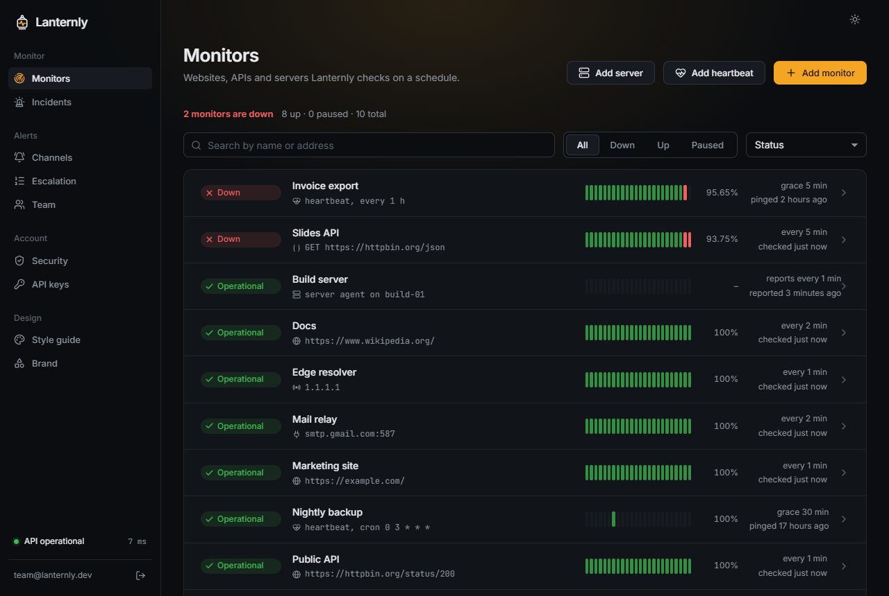

## The idea

The outages that hurt are usually the quiet ones. The website returns 200 while the API behind it
answers with the wrong body; the nightly backup stopped running three weeks ago and nobody noticed,
because a job that never starts never sends an error; the disk on the build server fills up a little
more each day. A plain "is the page up?" check sees none of that.

Lanternly treats each of these as a first-class monitor: an API monitor checks what comes back, not just
the status code; a heartbeat raises the alarm when a ping _doesn't_ arrive; a small agent on the server
reports its own numbers once a minute. When one goes down, an escalation policy decides who hears about
it first, and the alert itself carries a signed link to say "I'm on it", so the next person in line isn't
woken for nothing.

## What a monitor guarantees

These hold for every monitor, whatever its type. Each one is pinned down by a test.

| Rule                                                              | How it's kept                                                                                                                                                                                        |
| ----------------------------------------------------------------- | ---------------------------------------------------------------------------------------------------------------------------------------------------------------------------------------------------- |
| A monitor is only down after its retries are used up.             | Every check runs once plus up to `retries` more (default 1, at most 5) and stops at the first success. One dropped packet is not an outage.                                                          |
| An outage opens one incident and sends one alert.                 | State changes follow a pure state machine (`worker/src/state.ts`). Going down opens an incident and alerts; staying down does nothing; coming back closes it with a single "back up" message.        |
| A result is recorded together with what it caused, or not at all. | The check result, the monitor's new state and the incident change are written in one transaction with the monitor's row locked. A result that raced with an edit or a pause is dropped.              |
| A slow monitor isn't counted as down.                             | A monitor with a "slow after" limit turns _degraded_: one warning when it starts, no incident, nothing more while it stays slow.                                                                     |
| Checks never reach your private network.                          | An SSRF guard (`db/src/network.ts`) refuses private, loopback, link-local and metadata addresses when a monitor is saved and again before every check, since DNS answers can change between the two. |
| No account sees another account's data.                           | Every query for monitors, incidents, channels and keys is scoped to its owner. A suspended account's checks stop, and it sends no alerts.                                                            |
| Checks run at most every 30 seconds.                              | The interval is 30 to 300 seconds; a plan can raise the floor.                                                                                                                                       |

## Heartbeats, assertions and escalation

### Heartbeats

A heartbeat expects a ping on a fixed period (`every 1 h`) or a cron schedule
(`0 3 * * *`) plus a grace time. The job ends with one line:

```sh
0 3 * * * /usr/local/bin/backup.sh && curl -fsS https://<your-domain>/ping/<token>
```

`/ping/<token>/start` marks the start of a run, so Lanternly can tell a job that hangs from one that never
started, and `/ping/<token>/fail` reports a failure at once. A POST body (the job's output) is kept,
trimmed, so the incident shows what went wrong. The API and the worker share one function for "when is the
next ping due", so they can never disagree about whether a ping is late.

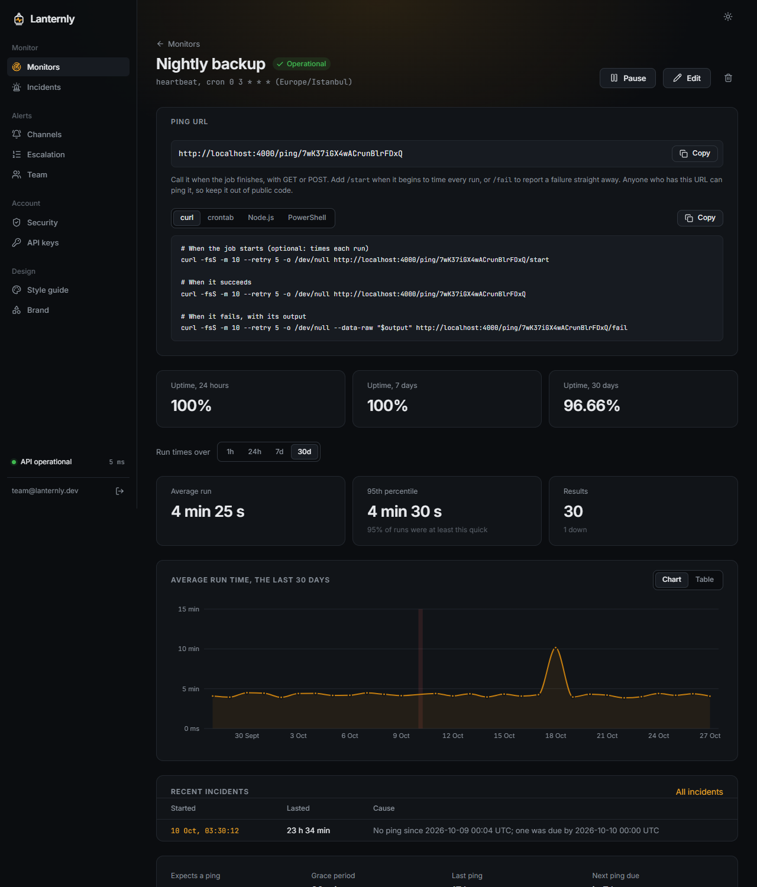

### Assertions

An API monitor sends a request (method, headers, body) and checks the JSON that comes
back against rules: `equals`, `not equals`, `contains`, `greater than`, `less than`, `exists`,
`not exists`, on a dotted path such as `slideshow.author`. Every rule's verdict is stored with the check,
so a failure reads as expected against received rather than "assertion failed". Request headers often
hold tokens, so they are encrypted at rest.

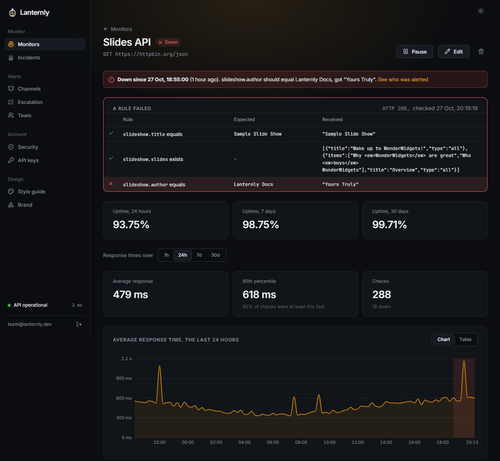

The monitor above still answers HTTP 200, so a status-code check would call it healthy. The third rule
expects `slideshow.author` to be `Lanternly Docs` and gets `"Yours Truly"`, and that row is what the
incident and the alert show.

### Escalation

A policy is an ordered list of steps: who to reach (a team member by email, or one of
your Slack, Telegram or webhook channels) and how many minutes to wait before the next step. Every alert
carries a link signed with HMAC-SHA256 for that incident and that recipient. Opening it acknowledges the
incident without signing in, which stops the escalation; the timeline records who acknowledged it and
when. Without a policy, everyone is alerted at once.

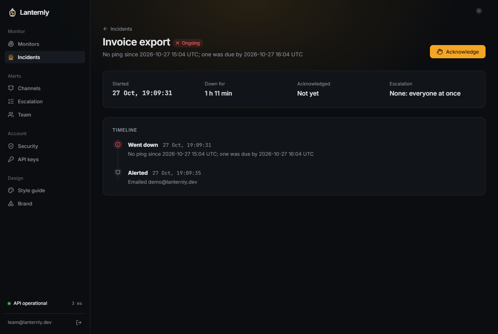

## What is stored, and what is public

| Data                                                                  | Stored as                                                           | Who can read it                                |
| --------------------------------------------------------------------- | ------------------------------------------------------------------- | ---------------------------------------------- |
| Passwords                                                             | argon2id hash                                                       | Nobody, not even an admin                      |
| TOTP secrets, channel tokens and webhook secrets, API monitor headers | AES-256-GCM, key from `ENCRYPTION_KEY`                              | The worker and API, to use them                |
| Refresh tokens, API keys, agent keys, reset and invite links          | SHA-256 hash                                                        | Nobody: a database leak yields no usable token |
| Access tokens                                                         | Signed JWT, 15 minutes, kept in browser memory only                 | The tab that holds it                          |
| Check results                                                         | Raw for 7 days, then hourly rollups                                 | The monitor's owner                            |
| Heartbeat pings and their output                                      | 30 days                                                             | The monitor's owner                            |
| Agent metrics                                                         | 30 days                                                             | The monitor's owner                            |
| Admin actions                                                         | Append-only audit log (a database trigger blocks edits and deletes) | Super admins                                   |

Reachable without signing in, and what each one reveals:

| Endpoint                       | Reveals                                                                  |
| ------------------------------ | ------------------------------------------------------------------------ |
| `GET /api/health`              | Whether the API and the database are up, and the database's latency      |
| `GET\|POST /ping/<token>`      | Nothing; answers `OK` to a known token                                   |
| `GET /api/ack/<id>?by=…&sig=…` | The monitor's name and the incident's state, only with a valid signature |
| `POST /api/agent/report`       | Nothing; needs the agent's key                                           |
| `/api/v1/monitors`             | The key owner's monitors, only with an API key                           |
| `/docs`                        | The public API's reference                                               |

## What it cannot tell you

Every check runs from the one machine the worker is on. If that machine's network has a problem,
monitors look down when they aren't, and if your site is broken only in another region, Lanternly won't
see it.

Checks run every 30 seconds at most, so an outage shorter than the interval can fall between two checks
and never be recorded. Retries help in the other direction: one retry filters out most blips, at the
cost of delaying the alert by one attempt, and a flaky target can still raise a false alarm.

A heartbeat only knows that a ping arrived. It can't tell whether the backup that sent it can actually
be restored. Likewise the agent measures only the machine it runs on.

Ping (ICMP) checks call the system's `ping` command, so it has to be installed where the worker runs.

## The dashboard

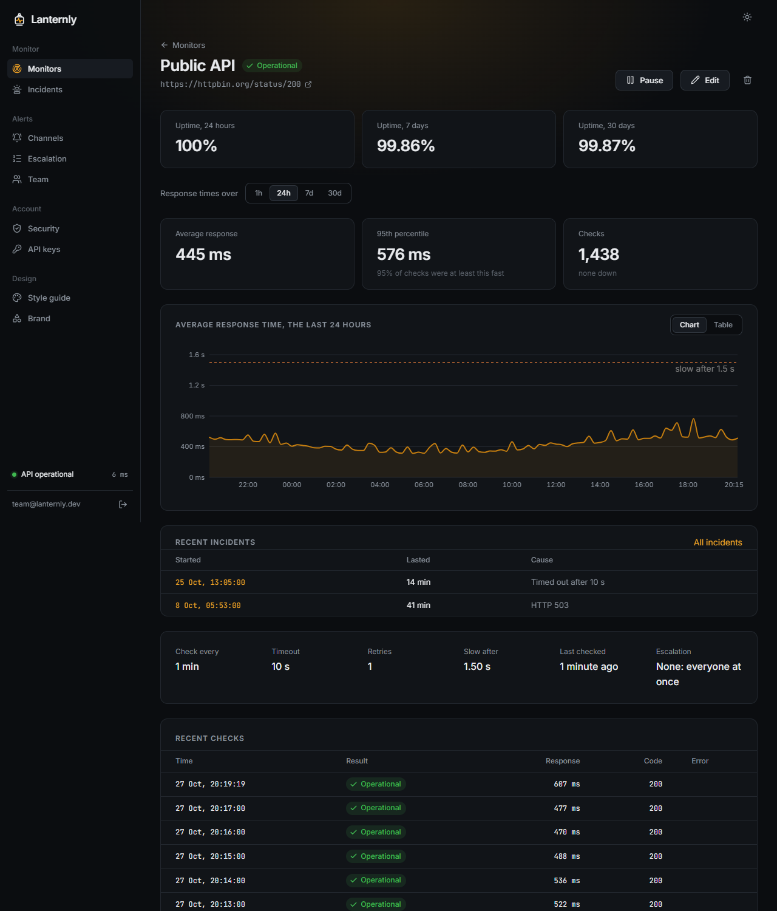

A monitor's page shows uptime over 24 hours, 7 days and 30 days, the average and 95th-percentile response
time, a response-time chart with outages shaded and the "slow after" line drawn, its recent incidents and
its latest checks. Results older than seven days are kept only as hourly rollups, and the figures read
raw checks and rollups together as one series.

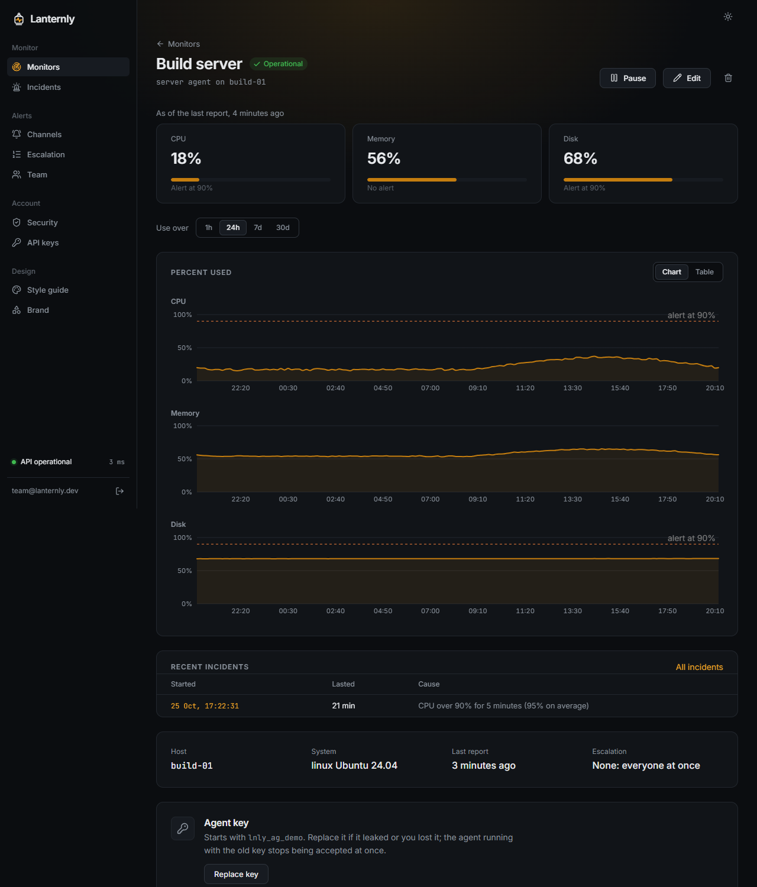

A server agent is a small Node process (`agent/`) that sends CPU, memory and disk once a minute. Lanternly
never connects to it. The monitor goes down when a disk is more than 90% full, when the CPU stays above
90% for five minutes on end (a single spike doesn't count), or when three reports in a row don't arrive.

The dashboard works on a phone too:

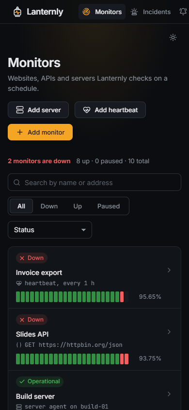

## The admin panel

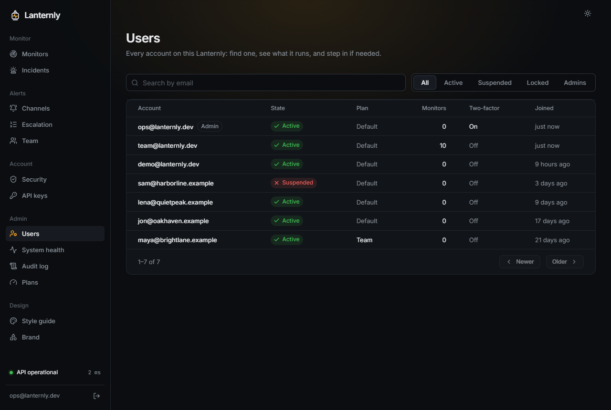

A super admin can search and filter every account, see what it runs and how close it is to its plan's
limits, suspend or reactivate it, unlock it after too many wrong passwords, and email a password reset
link that works for 24 hours. The admin pages need two-factor sign-in; an account without it is sent to
set it up first, and anyone else gets the ordinary "not found" page.

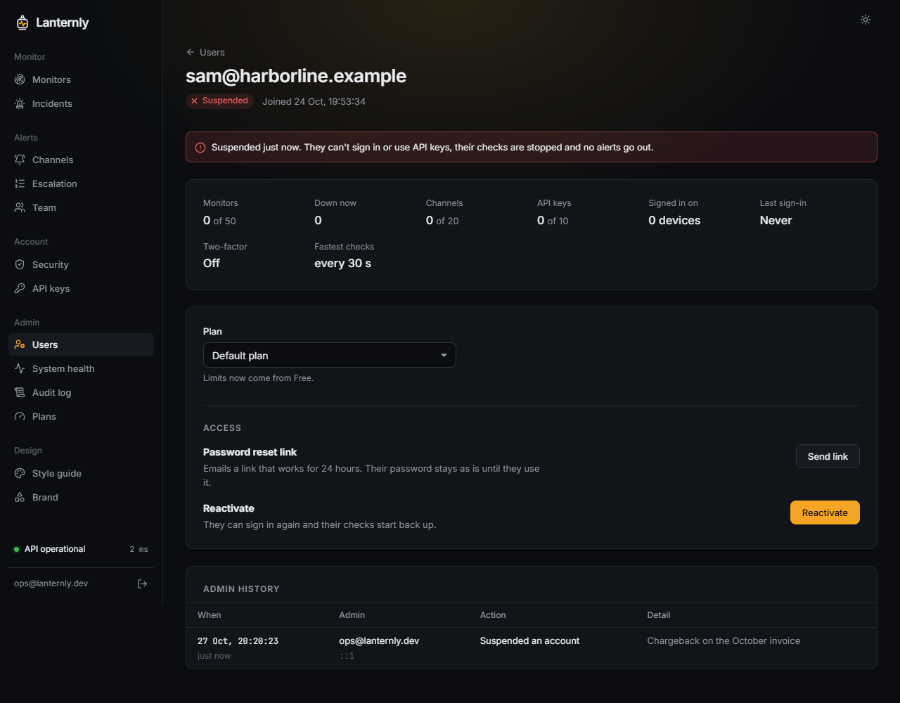

Suspending signs the account out everywhere, blocks sign-in, refresh and API keys, stops its checks and
silences its alerts. Nothing is deleted, and reactivating puts the checks back on their schedule. Admins
can't suspend themselves or each other.

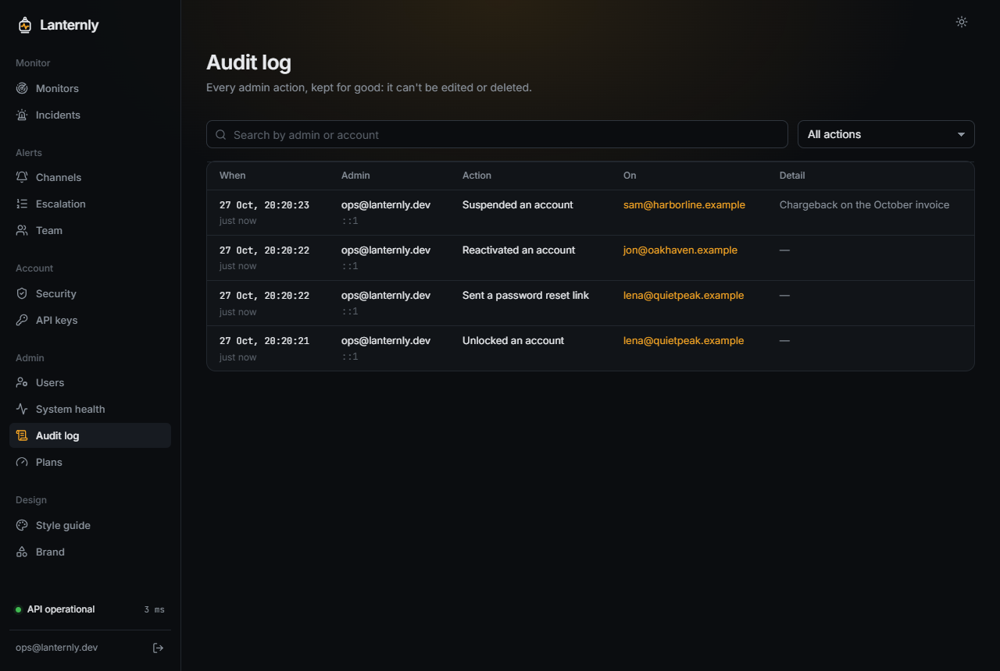

Every admin action lands in the audit log with the admin, the address they acted from and, where it
helps, the reason or the change (`Default → Team`, `monitors 200 → 100`). The append-only rule lives in
the database, in a trigger, so an `UPDATE` or `DELETE` on the table fails even when it doesn't come from
the API. Someone who owns the database could still drop the trigger; the log protects against mistakes
and against a compromised API, not against the database's owner.

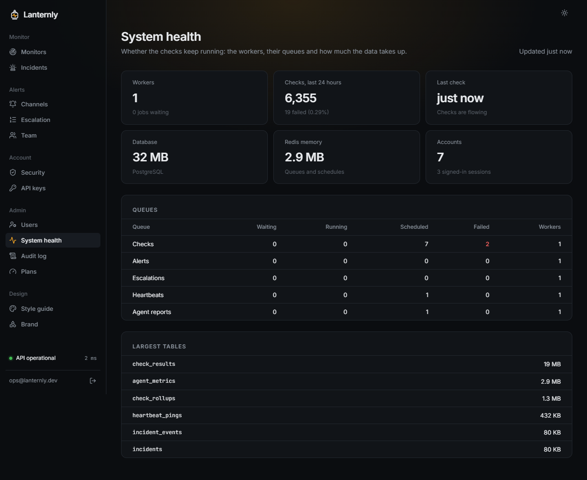

System health refreshes every ten seconds. It shows how many workers are connected, how many checks ran
in the last 24 hours and how many failed, when the last check finished, and each queue's waiting,
running, scheduled and failed jobs. A red "Stalled" appears when no check has finished for a minute and a
half, which usually means the worker or Redis is gone.

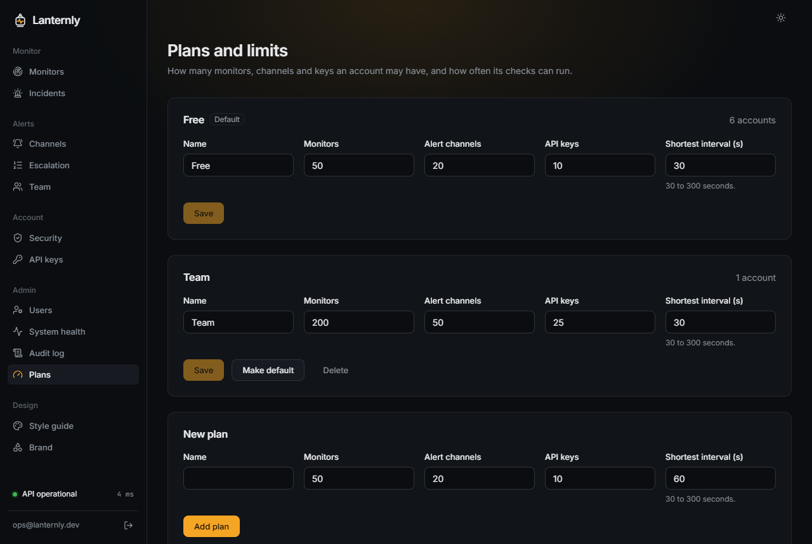

Plans set how many monitors, channels and API keys an account may have and how often its checks can run.
Accounts without a plan of their own use the default one. Lowering a limit takes nothing away: an account
over it keeps what it has and just can't add more.

## Repository layout

```
api/                  Express API
  src/auth/           sign-up, sessions, refresh-token rotation, two-factor, lockout, resets
  src/monitors/       monitor CRUD, stats and the shared monitor routes
  src/heartbeats/     heartbeat settings and the /ping endpoints
  src/channels/       Slack, Telegram and webhook channels
  src/escalation/     escalation policies
  src/incidents/      incidents, acknowledgements and the signed ack links
  src/team/           team members and invites
  src/agents/         server agents and their reports
  src/api-keys/       API keys
  src/v1/             the public REST API's OpenAPI document
  src/admin/          users, plans, system health and the audit log
  src/plans.ts        plan limits, enforced on every create
worker/               BullMQ worker
  src/checks/         http, api, tcp, dns and ping checks
  src/state.ts        up, down and degraded transitions
  src/alerts.ts       notifications and the escalation timer
  src/heartbeats.ts   finds heartbeats that went quiet
  src/rollup.ts       hourly rollups and retention
agent/                the server agent: cpu, memory and disk
db/                   Prisma schema, migrations and the code api and worker share
  src/network.ts      the SSRF guard
  src/crypto.ts       AES-256-GCM for secret columns
web/                  React dashboard
  src/pages/          monitors, incidents, alerts, settings and admin pages
  src/components/     the design system's pieces
deployments/          production compose file and Caddy config
docs/screenshots/     images used in this README
```

## Requirements

| Tool       | Version                | Why                                                                      |
| ---------- | ---------------------- | ------------------------------------------------------------------------ |
| Node.js    | 22 or newer (`.nvmrc`) | api, worker, agent and the web build                                     |
| PostgreSQL | 16                     | everything that lasts                                                    |
| Redis      | 7                      | the check schedule and job queues                                        |
| Docker     | with Compose v2        | runs PostgreSQL, Redis and Mailpit locally, and everything in production |

## Running it locally

```sh
git clone https://github.com/ssenasahin/lanternly.git
cd lanternly
npm install
cp .env.example .env          # then fill in JWT_SECRET, ENCRYPTION_KEY and SEED_DEMO_PASSWORD
docker compose up -d          # PostgreSQL, Redis and Mailpit
npm run db:migrate            # creates the tables
npm run db:seed               # demo@lanternly.dev with monitors and 30 days of history
npm run dev                   # api on :4000, worker, web on http://localhost:5173
```

Sign in as `demo@lanternly.dev` with the password you put in `SEED_DEMO_PASSWORD`. Every email the app
sends (alerts, resets, invites) shows up in Mailpit at http://localhost:8025.

To use the admin panel, create a super admin. It asks for the email, then for the password at a hidden
prompt, so the password never ends up in a file or the shell history:

```sh
npm run admin:create
```

Checks before a commit, the same ones CI runs:

```sh
npm run format:check
npm run lint
npm run typecheck
npm run build
npm test                      # uses its own database, lanternly_test, created on the first run
```

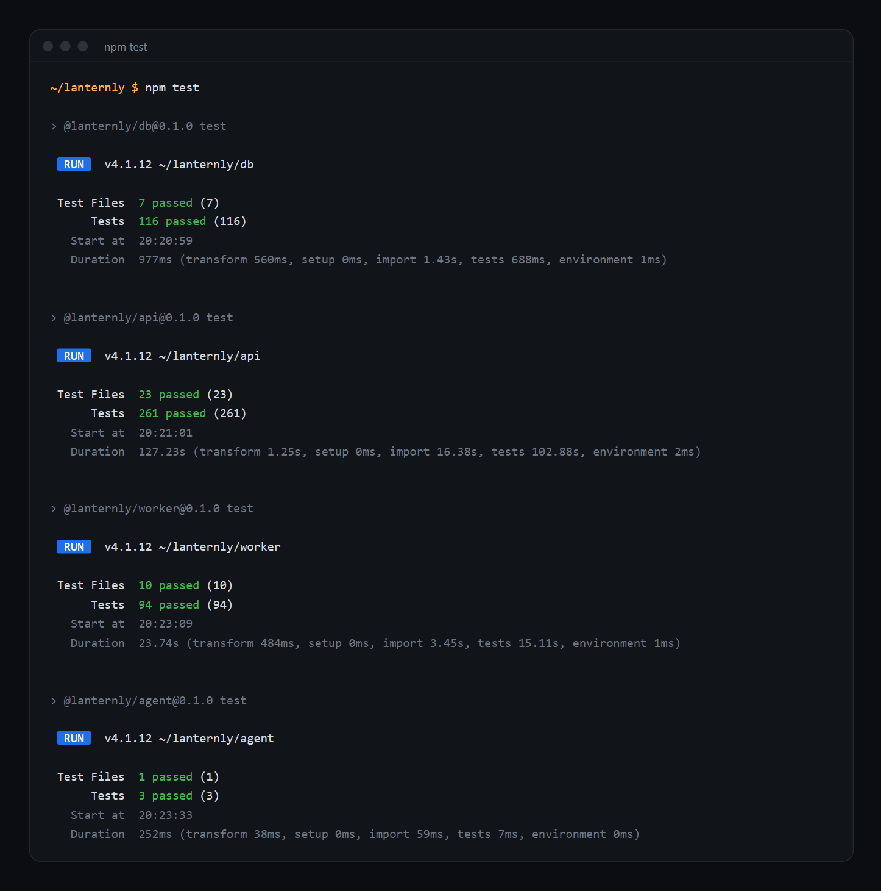

The API and worker tests run against a real PostgreSQL rather than mocks, because the bugs they are there
to catch (constraints, transactions, two checks finishing at once) only show up in a real database.

## Deployment

Production runs on one machine with Docker: PostgreSQL, Redis, a migration step, the API, the worker,
and Caddy, which serves the dashboard, proxies `/api`, `/docs` and `/ping` to the API, and gets an HTTPS
certificate on its own. Keeping the dashboard and the API on one origin keeps the refresh cookie
first-party (`SameSite=Strict`, `Secure`, `HttpOnly`).

```sh
cp deployments/.env.example deployments/.env   # domain, database password, secrets, SMTP
docker compose -f deployments/compose.yml --env-file deployments/.env up -d --build
docker compose -f deployments/compose.yml --env-file deployments/.env exec api \
  node api/dist/cli/create-admin.js
```

Point the domain's DNS at the machine and open ports 80 and 443 first. Each deploy applies new migrations
before the API and worker start.

To check a deployment:

```sh
$ curl -s https://<your-domain>/api/health
{"status":"ok","database":"up","latencyMs":21}

$ curl -s https://<your-domain>/ping/<heartbeat-token>
OK
```

## Roadmap

| Stage | Work                                                                          |
| ----- | ----------------------------------------------------------------------------- |
| Done  | Secure sign-in with two-factor, lockout and session management                |
| Done  | HTTP, API, TCP, DNS and ping monitors; heartbeats; server agent               |
| Done  | Incidents, Slack, Telegram and webhook alerts, escalation and acknowledgement |
| Done  | Public REST API with keys and an OpenAPI reference                            |
| Done  | Admin panel: users, plans and limits, system health, audit log                |
| Next  | Checks from more than one region, so a local network problem isn't an outage  |
| Next  | A public status page per account                                              |
| Next  | Monthly SLA reports                                                           |

## License

MIT. See [LICENSE](LICENSE).
